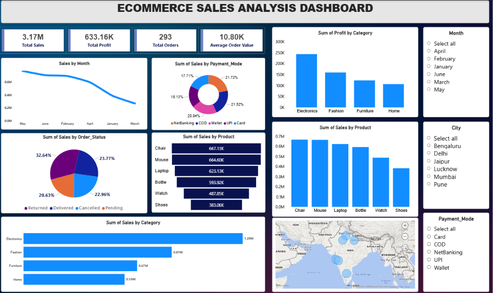

# E-Commerce Analysis

An end-to-end e-commerce analytics project using **Jupyter Notebook, Python (Pandas, NumPy), MySQL, and Power BI**. The workflow explores data cleaning, feature engineering, SQL-based business analysis, and dashboard reporting.

## Dashboard



The image above is the original dashboard screenshot supplied for this project, placed unchanged in the `dashboard/` folder. The Power BI report is stored alongside it.

## Tech Stack

- **Jupyter Notebook** — interactive data exploration
- **Python / Pandas / NumPy** — cleaning and feature engineering
- **MySQL** — business queries and aggregation
- **Power BI** — KPI reporting and interactive visualization

## Repository Structure

```text
Ecommerce-Analysis/
├── dashboard/
│   ├── dashboard.png
│   ├── ecommerce_sales_dashboard.pbix
│   └── README.md
├── data/
│   ├── sample_ecommerce.csv
│   └── README.md
├── docs/
│   └── data-quality-notes.md
├── python/
│   ├── project_end.ipynb
│   ├── data_cleaning.py
│   ├── pandas_query.png
│   └── README.md
├── sql/
│   ├── ecommerce_sales_analysis.sql
│   ├── mysql_queries.png
│   └── README.md
├── requirements.txt
├── .gitignore
├── LICENSE
└── README.md
```

> **Dataset status:** The full original workbook and cleaned CSV are not currently present in this GitHub repository. The data folder currently contains the sample CSV only. Add the approved, privacy-reviewed source files to `data/` before claiming that the full workflow can be reproduced from a fresh clone.

## Getting Started

1. Clone the repository.
2. Install dependencies:

   ```bash
   python -m pip install -r requirements.txt
   ```

3. Open `python/project_end.ipynb` in Jupyter Notebook or JupyterLab.
4. Review and run `sql/ecommerce_sales_analysis.sql` in MySQL Workbench after configuring the database and loading the `orders` table.
5. Open `dashboard/ecommerce_sales_dashboard.pbix` in Power BI Desktop. Update its data source and refresh the report if required.

## Metric Notes

The notebook's `Profit` feature uses a fixed 20% of net amount. This is an assumed margin, not verified accounting profit. Review `docs/data-quality-notes.md` before interpreting results.

## About Me

I'm **Suraj**, a B.Tech AIML student interested in data analytics, business intelligence, and practical data projects. This repository documents my work with notebooks, data preparation, SQL analysis, and dashboard reporting.

**Technologies:** #Jupyter #Pandas #MySQL #Python #PowerBI #DataAnalytics

GitHub: [@surajyadav011](https://github.com/surajyadav011)
